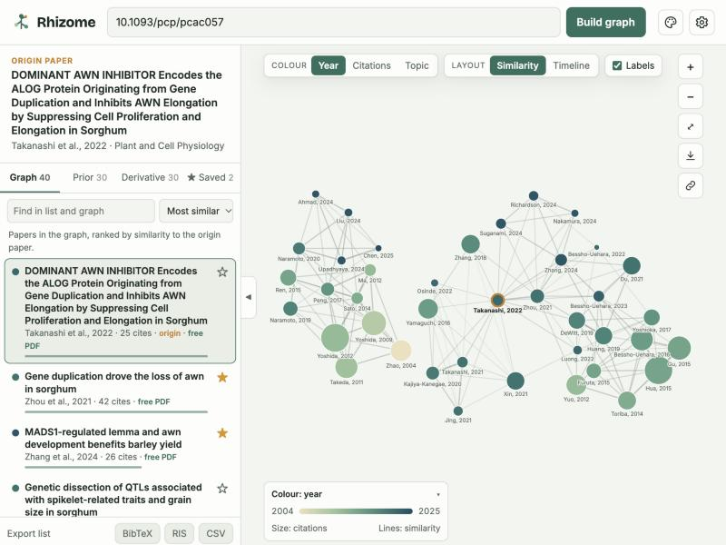
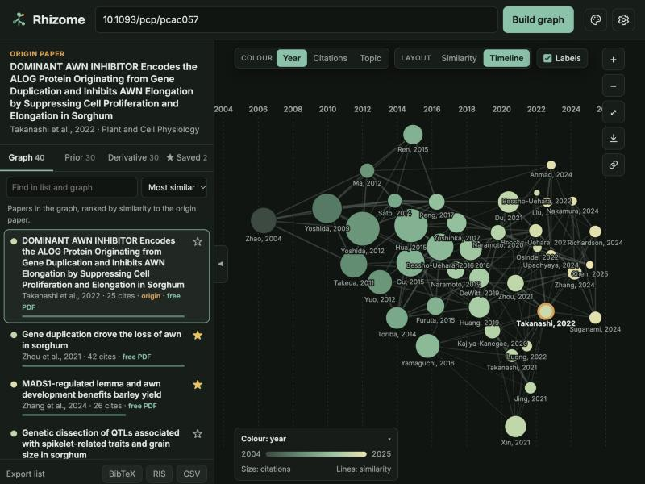

# Rhizome

**A free, open-source map of the literature around any paper.**

[](https://israel-tetteh.github.io/rhizome/)
[](LICENSE)
[-5b6bbf?style=flat-square)](https://openalex.org)
[](tests/)

Give Rhizome one paper (a DOI, a title, an OpenAlex id, or a Connected Papers link) and it draws an
interactive graph of the papers most closely related to it. Similar papers sit close together and are
linked, even when they never cite each other. No account, no subscription, no tracking.

**Use it now:** https://israel-tetteh.github.io/rhizome/



<details>
<summary>Timeline layout in the Night theme</summary>



</details>

## Why

Mapping a field around a key paper is one of the fastest ways to start a literature review, but the
popular tools for it are paid. Rhizome does the same job with open data and open code, so any student
or researcher can use it, host it, or improve it.

## What you get

- **Similarity graph.** About 40 related papers (25 to 80, set in Settings). Node size shows citations
  and line thickness shows how strongly two papers are related.
- **Colour by year, citations or research topic.** In topic mode the legend lists the main OpenAlex
  topics in the graph; click one to highlight its papers.
- **Start from several papers.** Paste a list of DOIs, import a BibTeX or RIS export from Zotero
  (or Mendeley, EndNote), or use your saved papers. Rhizome maps the papers most related to the whole
  set (up to 25 origins). Any paper can also be added as an extra origin from its details panel.
- **Three layouts.** *Similarity* pulls related papers together; *Timeline* spreads them by publication
  year; *Map* plots them on two axes you choose (year, citations, references, similarity or connections).
- **Author pages.** Click any author to see their profile, h-index and papers (most cited or newest),
  and map their five most cited papers in one click.
- **Filters and hiding.** Limit lists and the graph to a year range or to papers with a free full text.
  Hide a noisy paper (for example a generic methods paper) and the next most similar one takes its place.
- **Trail.** Every graph you visit in a session stays in a trail at the top of the list, to hop back.
- **Prior works.** Papers cited by many papers in the graph, usually the foundations of the field.
- **Derivative works.** Papers that cite many papers in the graph, usually recent reviews and follow-up work.
- **Saved papers.** Star (☆) any paper from any graph. Your saved list stays in your browser between visits.
- **Paper details.** Authors, venue, topic, citations and abstract, with links to a free full-text copy
  when one exists, the publisher, OpenAlex and Google Scholar. Double-click a node to re-centre on it.
- **Find in graph.** Typing in the list filter also highlights matching papers in the graph.
- **Export for your reference manager.** Any list, or your saved papers, exports to **BibTeX**, **RIS**
  (Zotero, Mendeley, EndNote) or **CSV**. In Zotero use *File → Import…*. The graph downloads as PNG or SVG.
- **Six colour themes.** System, Meadow (light), Night (dark), Paper (sepia), Ocean and High contrast.
- **Collapsible side panels** to give the graph the whole screen.
- **Recent graphs** on the home page, and a shareable link for every graph, e.g.
  `https://israel-tetteh.github.io/rhizome/#/W4226146299`.
- **Keyboard shortcuts:** `/` search, `F` fit, `T` timeline, `M` map, `S` star, `H` hide,
  `[` and `]` panels, `Esc` clear.

## How similarity is computed

Rhizome collects a neighbourhood of a few hundred papers around the origin paper:

1. its references and the papers that cite it,
2. OpenAlex's related works,
3. papers that cite the origin's most specific (least-cited) references, which finds "siblings"
   that work on the same problem without citing the origin,
4. papers the neighbourhood cites repeatedly.

For any two papers A and B it then combines two classic bibliometric measures:

- **Bibliographic coupling:** the number of references A and B share,
- **Co-citation:** the number of papers in the neighbourhood that cite both A and B,

each normalised by the geometric mean of the list sizes (Salton's cosine), plus a small bonus when
one cites the other. The papers most similar to the origin become the graph, and each keeps links to
its five most similar neighbours. A force-directed layout then pulls similar papers together.

Building one graph takes about 12 OpenAlex requests and a few seconds.

## Data and cost

All data comes from [OpenAlex](https://openalex.org), an open index of 250M+ scholarly works released
under CC0. OpenAlex is free; without an API key each network gets a small daily budget, which covers
dozens of graphs a day. For heavy use, get a [free OpenAlex API key](https://openalex.org/settings/api)
and paste it into Rhizome's Settings. The key is kept only in your browser.

Coverage follows OpenAlex: very new papers, or papers whose references OpenAlex has not indexed, give
smaller graphs.

## Run it yourself

Rhizome is a static site: plain HTML, CSS and JavaScript with [d3](https://d3js.org) loaded from a CDN.
There is no build step and no server.

```bash
git clone https://github.com/Israel-Tetteh/rhizome.git
cd rhizome
python3 -m http.server 8000   # then open http://localhost:8000
npm test                      # unit tests for the graph builder and exports (Node 18+)
```

To host your own copy, fork the repo and turn on GitHub Pages (Settings → Pages → Deploy from branch → `main` / root).

## Project layout

| File | What it does |
| --- | --- |
| `index.html`, `css/style.css` | Page and styles (light and dark) |
| `js/openalex.js` | Small OpenAlex API client with caching and retries |
| `js/graph-builder.js` | Neighbourhood collection, similarity, prior and derivative works |
| `js/graph-view.js` | Interactive d3 force layout |
| `js/export.js` | BibTeX, RIS and CSV export |
| `js/app.js` | Search, routing, lists and the detail panel |
| `tests/` | Node tests with a mocked API |

## Contributing

Issues and pull requests are welcome. Ideas on the list: graphs built from several origin papers, saving whole graphs,
and an R/Shiny companion.

## How to cite

If Rhizome helps your research, please cite it. GitHub's **Cite this repository** button (right-hand
side of the repo page) gives APA and BibTeX versions from [`CITATION.cff`](CITATION.cff):

> Tetteh, I. T. (2026). *Rhizome: a free, open-source explorer of the literature around any paper*
> (Version 1.0.0) [Computer software]. https://github.com/Israel-Tetteh/rhizome

Please also cite OpenAlex, which provides the data:

> Priem, J., Piwowar, H., & Orr, R. (2022). OpenAlex: A fully-open index of scholarly works, authors,
> venues, institutions, and concepts. arXiv:2205.01833.

## Licence

MIT, see [LICENSE](LICENSE). Data from OpenAlex is CC0.
